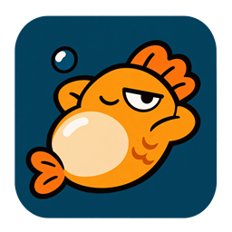

<div align="center">
  
  <h1>fishing</h1>
  <p>Windows 桌面摸鱼助手</p>
</div>

把摄像头画面放在桌面角落，按画面中的人数或指定人员触发提醒、切换窗口。预览、识别条件和触发动作可以独立配置。

## 下载

支持 Windows x64。个人安装可以选择 EXE，也提供 MSI。安装会创建开始菜单快捷方式，桌面快捷方式可在安装时选择。 [GitHub Releases](https://github.com/zhkai-ybwn/fishing/releases)

## 怎么用

首页集中显示预览、触发条件和触发动作。按需打开开关，然后点「启动」。要更换摄像头或改其他偏好，打开「设置」。

- **悬浮预览。** 「置顶实时预览」默认是无边框小窗。按住画面可移动，拖动右下角可缩放，右键可关闭。在「设置 → 摄像头与预览」可以恢复标题栏或调节亮度。
- **按人数触发。** 打开「按人脸数量触发」，输入正整数并按 Enter。默认 2 张，自己出现在画面中时也计入。
- **识别指定人员。** 在「设置 → 人员录入」填写名称并录入，再打开首页的「识别指定人员」。使用仅有一张清晰正脸的 JPG 或 PNG，也可以用摄像头录入。
- **选择触发动作。** 「显示桌面提示」和「切到目标应用」可以同时开启。切窗目标从已打开的应用或窗口中选择。

Windows 限制后台应用激活目标窗口时，fishing 会尝试把目标窗口置前，键盘焦点由原窗口持有。实际切窗结果显示在主窗口。

### 提醒与托盘

在「设置 → 提示文字」可以使用固定文案，也可以用 `{时长}` 显示本次检测已运行多久。例如输入 `已专注{时长}，休息一下吧。`。用「预览提醒」查看效果，用「恢复默认」换回默认文案。

「收起到托盘」会隐藏设置、任务栏按钮和悬浮预览。运行中的检测和触发动作会继续执行。右键托盘图标可以重新打开设置、启动或暂停检测，也可以退出 fishing。

点击主窗口右上角的关闭按钮，默认询问「退出」或「收起到托盘」。勾选「记住这次操作」后，下次会直接执行。可以在「设置 → 应用 → 关闭窗口」修改选择。

### 应用内更新

在「设置 → 应用」中点击「检查更新」，即可查看 GitHub 上的最新正式版本。下载完成后，fishing 会按 GitHub 提供的 SHA-256 校验安装包。点击「退出并安装」即可打开安装程序。

从首版 v0.1.0 升级时，请先从 Releases 下载新版安装包。应用内更新从 v0.2.0 开始提供。

### 本地处理

摄像头画面和导入的照片都在本机处理。录入时保存人员名称和比对特征，可随时在设置中移除。

## 从源码运行

使用 Windows x64、PowerShell 7、Rust 1.90.0 和 Visual Studio 2022 C++ 构建工具。

```powershell
./packaging/Prepare-Assets.ps1
./packaging/Get-OnnxRuntime.ps1
cargo run --locked --bin fishing
```

前两步会准备并校验固定版本的模型、字体和 ONNX Runtime。构建时会把运行库放到应用同目录。

[贡献和发布流程](CONTRIBUTING.md) · [MIT 许可证](LICENSE) · [模型及依赖许可](THIRD_PARTY_NOTICES.md)
